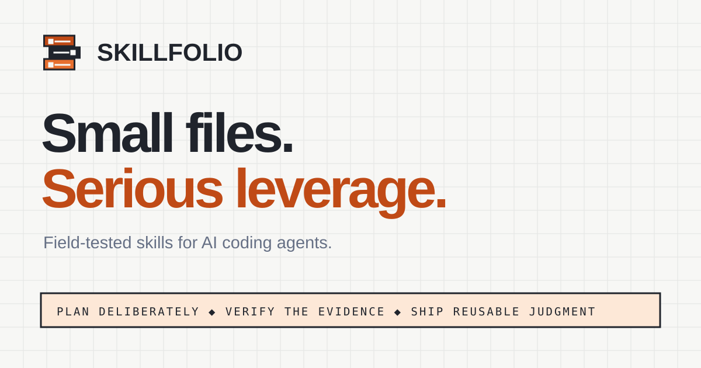
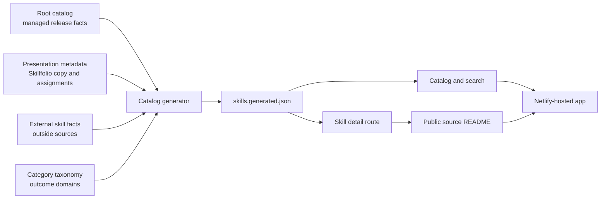

# Skillfolio

> A searchable portfolio for discovering, evaluating, and installing reusable skills for AI coding agents.

[](https://skillfoliox.netlify.app)
[](https://github.com/montasim/skills/commits/main)
[](https://www.supportkori.com/montasim)

Skillfolio gives developers one place to browse Montasim's reusable agent skills, understand what each skill does, inspect its source documentation, and copy a verified install command. The application lives in the `apps/skillfolio` directory of the skills monorepo, which now provides both the deployed source and public issue tracker.

**[Open Skillfolio](https://skillfoliox.netlify.app) · [Explore Write Complete Project README](https://skillfoliox.netlify.app/skills/write-complete-project-readme) · [Report an issue](https://github.com/montasim/skills/issues)**

[](https://skillfoliox.netlify.app)

## Why Skillfolio?

Agent skills are small instruction packages, but evaluating them often requires moving between repositories, releases, README files, and install instructions. Skillfolio turns that scattered information into a consistent catalog experience:

- Search and filter a curated library from one responsive interface.
- Compare purpose, category, status, version, compatibility evidence, and common uses.
- Read each public source README without leaving its detail page.
- Open each managed skill's canonical npm package and copy the install command derived from its distribution facts.
- Open the exact source directory whenever deeper verification is needed.

Skillfolio is a deliberately reviewed portfolio, not an automatically indexed marketplace. Managed release facts come from the monorepo inventory; presentation copy remains owned by the application.

## Current capabilities

- Searchable and category-filtered skill catalog
- Featured-skill and library-status summaries
- Dedicated, shareable route for every published skill
- GitHub-flavored Markdown rendering with tables, code blocks, links, and images
- Relative README links and images resolved against a repository and optional monorepo subdirectory
- Loading skeletons, retry states, and direct-source fallbacks
- Copy-to-clipboard install commands
- Direct npm package links for every managed skill
- Responsive navigation and reduced-motion-aware animation
- Canonical metadata, Open Graph and Twitter cards, JSON-LD, sitemap, robots file, favicon, web app manifest, and install icons
- Netlify-compatible TanStack Start server-side rendering

The checked-in runtime catalog is generated, so both local builds and Netlify builds from the central repository reflect the current source files.

## Using the live application

1. Open the [Skillfolio library](https://skillfoliox.netlify.app).
2. Search by skill name, summary, category, or description, or select a category filter.
3. Open a card to review its status, documented format, installer tests, runtime evidence, source, and rendered documentation.
4. Copy the install command from the installation panel.
5. Use **View on GitHub** or **View source** to inspect the original files.

The README panel loads from `raw.githubusercontent.com` in the browser. If GitHub is unavailable, blocked, or rate-limited, use the retry control or open the source repository directly.

## Catalog ownership

Skillfolio uses four editing authorities and one generated runtime file:

| Source | Owns |
| --- | --- |
| Root `catalog.json` | Managed skill versions, packages, distribution, repositories, provenance, license status, and dated compatibility evidence |
| [`src/data/categories.json`](src/data/categories.json) | Canonical outcome-based category names and definitions |
| [`src/data/skill-presentation.json`](src/data/skill-presentation.json) | Display names, categories, featured state, summaries, descriptions, and use cases |
| [`src/data/external-skills.json`](src/data/external-skills.json) | Source, version, and installation facts for skills maintained outside this monorepo |
| `src/data/skills.generated.json` | Reviewable runtime projection; generated, never edited directly |

Private, internal, and source-only local skills are withheld from the web catalog until their distribution and licensing are explicitly decided. A generator failure is intentional: missing presentation data, conflicting identities, unpublished managed entries, or multiple featured skills should stop the build instead of creating a misleading card.



## How it works

- TanStack Router creates the catalog route and `/skills/$slug` detail routes.
- `scripts/generate-skillfolio-catalog.mjs` joins stable release facts, the category taxonomy, and application presentation metadata before development, tests, and builds.
- The browser fetches the configured public README and renders it with `react-markdown` and `remark-gfm`.
- Raw HTML inside fetched Markdown is skipped. Relative links and images are rewritten to the configured repository, branch, and source directory.
- The application has no database, authentication system, application API, or content-management backend.
- Netlify's TanStack Start adapter packages the server entry point as a Netlify function during production builds.

## Technology

| Area | Technology |
| --- | --- |
| Application | TanStack Start, TanStack Router, React 19, TypeScript |
| Build | Vite 8, pnpm |
| Interface | Tailwind CSS 4, shadcn/ui, Radix UI, Lucide icons |
| Documentation rendering | react-markdown, remark-gfm |
| Typography | Geist Variable |
| Deployment | Netlify with `@netlify/vite-plugin-tanstack-start` |
| Data source | Generated local JSON and public source README files |

## Local development

### Prerequisites

- Node.js 24
- pnpm 10.30.3
- Git

No database, API key, or external service account is required. Internet access is needed only for installing dependencies and viewing README content fetched from GitHub.

From an existing monorepo checkout:

```bash
cd apps/skillfolio
pnpm install --frozen-lockfile
cp .env.example .env.local
pnpm dev
```

Open [http://localhost:3000](http://localhost:3000).

`VITE_SITE_URL` controls canonical links, social metadata, `robots.txt`, and `sitemap.xml`. The committed default is the production origin:

```dotenv
VITE_SITE_URL=https://skillfoliox.netlify.app
```

Use your own absolute origin for a fork or custom domain. This is public build configuration, not a secret.

## Adding or updating a skill

Start by deciding who owns the release facts.

### Managed by this monorepo

1. Add or update the skill in root `catalog.json`.
2. Add or update the matching `source.kind: "managed"` record in [`src/data/skill-presentation.json`](src/data/skill-presentation.json).
3. Confirm the managed skill is publicly distributable and has a resolvable repository or legacy repository.

### Maintained elsewhere

1. Add or update its canonical facts in [`src/data/external-skills.json`](src/data/external-skills.json).
2. Add or update the matching `source.kind: "external"` presentation record.
3. Verify its version, source URL, branch, and install command against primary evidence.

For either path, regenerate and verify:

```bash
npm run generate:skillfolio-catalog
cd apps/skillfolio
pnpm test
pnpm typecheck
pnpm build
```

Keep slugs unique and URL-safe, keep exactly one entry featured, and inspect the resulting detail route. The build regenerates `public/sitemap.xml` and `public/robots.txt` from the validated catalog.

## Development commands

Run application commands from `apps/skillfolio` unless shown otherwise.

| Command | Purpose |
| --- | --- |
| `pnpm generate:catalog` | Regenerate the runtime catalog from monorepo and application authorities |
| `pnpm dev` | Generate the catalog and start Vite on port 3000 |
| `pnpm generate:seo` | Regenerate `public/sitemap.xml` and `public/robots.txt` |
| `pnpm smoke:dev` | Start Vite on an available port and verify the development server responds |
| `pnpm test` | Generate the catalog and run Vitest |
| `pnpm lint` | Run ESLint |
| `pnpm typecheck` | Check TypeScript without emitting files |
| `pnpm check` | Check JavaScript and TypeScript formatting with Prettier |
| `pnpm format` | Rewrite JavaScript and TypeScript files with Prettier |
| `pnpm build` | Generate catalog and crawler files, then build client, server, and Netlify output |

The root command `npm run validate` also checks that the committed runtime catalog matches its authorities.

## Deployment

The site is deployed at [skillfoliox.netlify.app](https://skillfoliox.netlify.app) from the `main` branch of [`montasim/skills`](https://github.com/montasim/skills).

Netlify configuration is intentionally split so both monorepo builds and app-local development resolve paths correctly:

- Root `netlify.toml` selects the base directory `apps/skillfolio`.
- This directory's `netlify.toml` defines build command `pnpm run build` and publish directory `dist/client` without repeating the base.
- Node.js: 24
- pnpm: 10.30.3
- Canonical site URL: `https://skillfoliox.netlify.app`

The build writes the server handler to `.netlify/v1/functions/server.mjs`. `.netlify`, `dist`, and dependencies are generated artifacts and remain untracked.

Every push to the connected `main` branch can trigger a Netlify production build. After deployment-affecting changes, verify the homepage, representative skill routes, `/robots.txt`, `/sitemap.xml`, SSR behavior, source links, and social preview.

## Project structure

```text
apps/skillfolio/
├── src/
│   ├── components/                 Detail frame, README module, layout, and UI
│   ├── data/
│   │   ├── categories.json         Canonical category taxonomy
│   │   ├── external-skills.json    External release and source facts
│   │   ├── skill-presentation.json Skillfolio presentation metadata
│   │   └── skills.generated.json   Generated runtime catalog
│   ├── lib/                        Catalog, repository, and publishing modules
│   └── routes/                     Catalog and skill detail routes
├── public/                         Icons, preview assets, manifest, and crawler files
├── scripts/generate-seo.mjs        Sitemap and robots generator
├── scripts/check-dev-server.mjs    Local Vite and Netlify-adapter startup smoke check
├── prototypes/v1/                  Preserved static prototype
├── netlify.toml                     App-local build, publish, environment, and header rules
├── pnpm-lock.yaml                  Isolated application dependency lock
└── package.json
```

The catalog generator and Netlify configuration live at the monorepo root because both join application behavior to repository-wide facts.

## Status and limitations

- The catalog is curated and generated locally; it does not poll GitHub or npm automatically.
- The deployed site uses this monorepo as its Git source; uncommitted local changes do not reach Netlify.
- README rendering depends on public GitHub and `raw.githubusercontent.com` availability.
- Private repositories are unsupported because there is no authentication flow.
- Search and category filtering run in the browser against bundled JSON.
- Skillfolio does not store user accounts, form submissions, or catalog data in a database.
- Hosting and GitHub requests remain subject to those providers' policies and logs.

## Support and security

Use the central [skills GitHub Issues](https://github.com/montasim/skills/issues) for reproducible bugs and focused feature requests. Include the affected URL, browser, expected behavior, and sanitized actual behavior.

Do not post credentials, private repository URLs, tokens, or other sensitive details in a public issue. Follow the monorepo's root `SECURITY.md` disclosure guidance.

## Contributing

Read the root `CONTRIBUTING.md` before changing the application. Keep catalog facts evidence-based, preserve the authority split, and report the commands you ran.

## Funding

Optional support through [SupportKori](https://www.supportkori.com/montasim) helps maintain the catalog, hosting, and continued development. Bug reports, documentation improvements, and focused contributions are equally valuable.

## Author

Built and maintained by [Montasim](https://github.com/montasim).

## License

Skillfolio does not currently include an open-source license. Public source availability does not itself grant permission to copy, modify, or redistribute the application. See the monorepo's root `LICENSING.md`.
